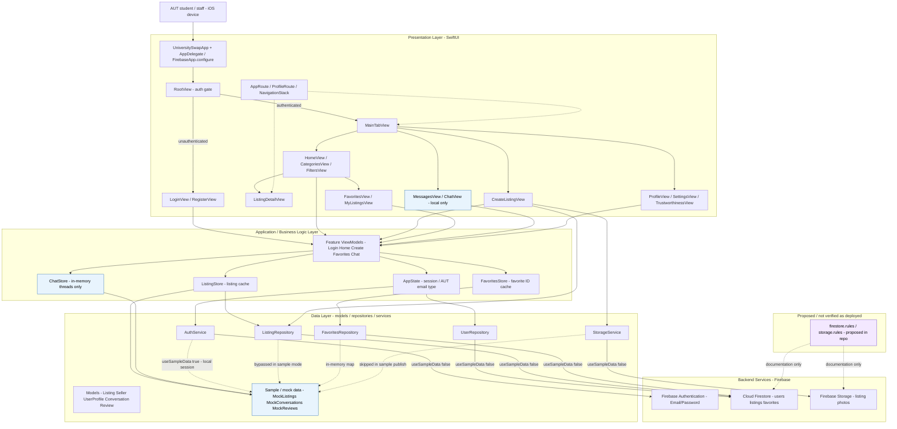

# UniversitySwap — System Architecture

**Project:** AUTSwap / UniversitySwap (iOS campus marketplace for AUT students)  
**Client:** Swift / SwiftUI iOS app  
**Backend:** Firebase (Auth, Cloud Firestore, Storage) — configured in the app; live usage gated by `AppConfig.useSampleData`  
**Document status:** Derived from the current `UniversitySwap-iOS` source tree (inspected). Not a design wish-list.

---

## 1. Technology stack (verified)


| Layer         | Technology                                                 | Evidence                                                  |
| ------------- | ---------------------------------------------------------- | --------------------------------------------------------- |
| UI            | SwiftUI                                                    | Feature views under `UniversitySwap/Features/`            |
| App lifecycle | SwiftUI `App` + `UIApplicationDelegateAdaptor`             | `UniversitySwapApp.swift`, `AppDelegate.swift`            |
| Local state   | `ObservableObject` / `@StateObject` / `@EnvironmentObject` | `AppState`, `ListingStore`, `FavoritesStore`, `ChatStore` |
| Backend SDK   | Firebase iOS SDK **10.24.0** (SPM)                         | `Package.resolved`, products Auth / Firestore / Storage   |
| Config        | `GoogleService-Info.plist`                                 | `UniversitySwap/Resources/GoogleService-Info.plist`       |
| Demo toggle   | `AppConfig.useSampleData` (currently `**true`**)           | `App/AppConfig.swift`                                     |


**Relationship to Firebase:** On launch, `AppDelegate` calls `FirebaseApp.configure()`. When `useSampleData == true` (classroom demo default), authentication, listings, favorites, and publish stay **local / in-memory** (or mock). When `useSampleData == false`, the same service types call Firebase Auth, Firestore (`users`, `listings`, `users/{uid}/favorites`), and Storage (`listings/{sellerId}/{listingId}/…`). Messaging/chat has **no** Firestore implementation in code.

---

## 2. Architecture style

The app follows a **layered SwiftUI MVVM-style** structure:

- **Presentation:** SwiftUI views + typed navigation (`AppRoute`, per-tab `NavigationStack`).
- **Application / business logic:** Feature `*ViewModel` classes plus session/store objects (`AppState`, `ListingStore`, `FavoritesStore`, `ChatStore`). There is **no** separate coordinator / router framework beyond SwiftUI navigation helpers.
- **Data:** Domain models + repositories/services that talk to Firebase or local sample data.
- **Backend:** Firebase cloud services (code present; demo mode largely bypasses live writes).

---

## 3. System architecture diagram

Exported image: `[SYSTEM_ARCHITECTURE.png](./SYSTEM_ARCHITECTURE.png)` (also `SYSTEM_ARCHITECTURE.mmd`).




**Legend**


| Style                    | Meaning                                                                                                                        |
| ------------------------ | ------------------------------------------------------------------------------------------------------------------------------ |
| Default nodes            | Implemented in source and used in the current demo and/or Firebase path                                                        |
| Blue-ish (Chat / sample) | Implemented **locally** only — no Firestore chat backend in code                                                               |
| Purple (rules)           | Rule files exist in-repo; README marks them **proposed / not deployed**; live Console state **not verified** from this machine |


---

## 4. Layer explanations

### 4.1 External actor

An **AUT student or staff member** uses the iOS app. Login validation accepts `@autuni.ac.nz` (student) or `@aut.ac.nz` (staff) email formats (`AUTAccountType` in `LoginViewModel.swift`).

### 4.2 Presentation Layer


| Component                      | Responsibility                                                                             |
| ------------------------------ | ------------------------------------------------------------------------------------------ |
| `UniversitySwapApp`            | Creates shared stores, injects `environmentObject`s, hosts `RootView`                      |
| `AppDelegate`                  | Calls `FirebaseApp.configure()` at launch                                                  |
| `RootView`                     | Shows loading / login / `MainTabView` based on `AppState`                                  |
| `MainTabView`                  | Tabs: Home, Categories, Messages, Profile; Create Listing as `fullScreenCover`             |
| Feature views                  | Screens listed in the diagram (browse, detail, publish, favorites, profile, chat UI, etc.) |
| `AppRoute` / `withAppRoutes()` | Typed navigation to listing detail, chat, trustworthiness                                  |


**Incomplete UI (implemented as placeholders, not full features):** Profile **My Transactions** uses `PlaceholderContent` (“not part of this demo”).

### 4.3 Application / Business Logic Layer


| Component        | Responsibility                                                                                |
| ---------------- | --------------------------------------------------------------------------------------------- |
| `AppState`       | Auth readiness, signed-in flag, current user id/email/profile; sample vs Firebase sign-in/out |
| `*ViewModel`     | Screen-specific state (search/filters, create draft, favorites load, chat composer, etc.)     |
| `ListingStore`   | Observable listing list; load/resolve/add; skips Firestore when sample mode is on             |
| `FavoritesStore` | Observable favorite IDs; optimistic toggle                                                    |
| `ChatStore`      | In-memory conversation threads, send/block/report — **not** synced to Firebase                |


There is no separate “controller” or “coordinator” type beyond these objects and SwiftUI navigation.

### 4.4 Data Layer


| Component                      | Responsibility                                                                                    |
| ------------------------------ | ------------------------------------------------------------------------------------------------- |
| Models                         | `Listing`, `Seller`, `UserProfile`, `Conversation`, `ChatMessage`, `Review`, filters/status enums |
| `MockListings` / related mocks | Seed data for demo mode                                                                           |
| `AuthService`                  | Wraps Firebase Auth API                                                                           |
| `UserRepository`               | Firestore `users/{uid}` profile upsert/fetch                                                      |
| `ListingRepository`            | Firestore `listings` fetch/create/decode                                                          |
| `FavoritesRepository`          | Firestore `users/{uid}/favorites/{listingId}` **or** in-memory set when sample mode is on         |
| `StorageService`               | Upload JPEG listing photos under `listings/{sellerId}/{listingId}/{index}.jpg`                    |


### 4.5 Backend Services


| Service                 | Used by code for                         | Notes                                                                     |
| ----------------------- | ---------------------------------------- | ------------------------------------------------------------------------- |
| Firebase Authentication | Sign-in / register / state listener      | Used when `useSampleData == false`                                        |
| Cloud Firestore         | Users, listings, favorites subcollection | Used when sample mode is off (favorites repo also has sample branch)      |
| Firebase Storage        | Listing image uploads                    | Called from `CreateListingViewModel.publish` only when sample mode is off |


**Not implemented against Firebase in this codebase:** real-time chat, push notifications, payments, transactions backend.

---

## 5. Main data flows (as implemented)

### 5.1 Authentication

```text
LoginView → LoginViewModel → AppState.signIn / register
  ├─ useSampleData true  → applySampleSession (local)  [demo path — current default]
  └─ useSampleData false → AuthService → Firebase Auth
                           → UserRepository.upsertProfile → Firestore users/{uid}
```

### 5.2 Retrieving listings (Home)

```text
HomeView.task → ListingStore.loadListings
  ├─ useSampleData true  → keep / seed MockListings  [demo path]
  └─ useSampleData false → ListingRepository.fetchActiveListings → Firestore listings
HomeViewModel.visibleListings → filter/sort for UI
```

### 5.3 Publishing a listing (+ images)

```text
CreateListingView → CreateListingViewModel.publish(seller)
  ├─ useSampleData true  → build Listing with id "sample-…" + local photo Data
  │                        → ListingStore.add  [demo path — no Storage/Firestore write]
  └─ useSampleData false → StorageService.uploadListingPhotos → Firebase Storage
                           → ListingRepository.createListing → Firestore listings
                           → ListingStore.add
```

### 5.4 Favorites

```text
FavoriteHeartButton / FavoritesView → FavoritesStore → FavoritesRepository
  ├─ useSampleData true  → in-memory map keyed by user id
  └─ useSampleData false → Firestore users/{uid}/favorites/{listingId}
FavoritesViewModel → ListingStore.resolveListings(ids) → cards / detail
```

### 5.5 Messaging (local only)

```text
MessagesView / ChatView → ChatStore / MockConversations
  → in-memory send/block/report only
  → no Firestore or other remote chat API in source
```

---

## 6. Implementation status summary


| Area                                                     | Status                                                                                       |
| -------------------------------------------------------- | -------------------------------------------------------------------------------------------- |
| SwiftUI shell, tabs, navigation                          | **Implemented**                                                                              |
| Login / register UI + AUT email validation               | **Implemented**                                                                              |
| Sample-data demo path (`useSampleData = true`)           | **Implemented** (current default)                                                            |
| Home / categories / filters / detail                     | **Implemented**                                                                              |
| Create listing (local in sample mode)                    | **Implemented**                                                                              |
| Favorites list + toggle                                  | **Implemented** (sample or Firestore per flag)                                               |
| My Listings (from `ListingStore`)                        | **Implemented**                                                                              |
| Firebase Auth / Firestore listings / Storage upload code | **Implemented in source**; live Console Auth enablement & rules deploy **not verified** here |
| Chat / Messages                                          | **Implemented UI + in-memory store only**                                                    |
| Trustworthiness / reviews                                | **UI + MockReviews** — no Firestore reviews API found                                        |
| My Transactions                                          | **Placeholder only**                                                                         |
| Security rules in `UniversitySwap-iOS/firebase/`         | **Proposed in repo**; README states not deployed — **live project rules not verified**       |


---

## 7. Configuration notes (no secrets)

- Bundle / plist: `GoogleService-Info.plist` is present under `UniversitySwap/Resources/`.
- Proposed rules documentation: `UniversitySwap-iOS/firebase/README-rules.md`, `firestore.rules`, `storage.rules`.
- This document does **not** reproduce API keys, tokens, or other secret values from the plist.

---

## 8. How to read this with the codebase

Primary folders:

```text
UniversitySwap-iOS/
  AppDelegate.swift
  UniversitySwap/
    App/           # entry, RootView, MainTabView, AppState, AppConfig
    Features/      # SwiftUI screens + ViewModels
    Services/      # Auth, repositories, stores, Storage
    Models/        # domain + mocks
    Navigation/    # AppRoute
    Resources/     # Assets, GoogleService-Info.plist
  firebase/        # proposed rules (documentation)
```

