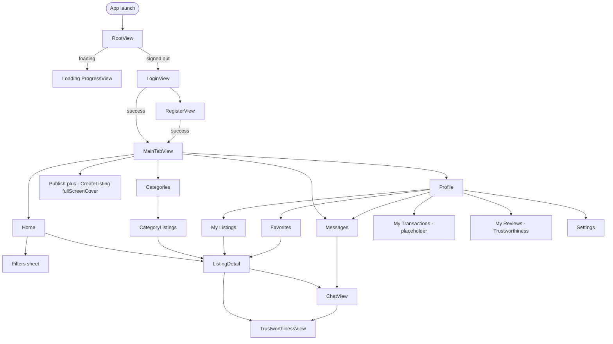

# UniversitySwap — UI Design (Current Implementation)

**Status:** Documented from the existing SwiftUI app (`UniversitySwap-iOS`). This is **not** a redesign proposal.  
**Visual tokens:** `UniversitySwap/Shared/Theme/AppTheme.swift`  
**Navigation:** `RootView` → `MainTabView` + `AppRoute` / `ProfileRoute`

Exported diagrams:

- [`UI_FLOW.png`](./UI_FLOW.png) — screen navigation map  
- [`UI_WIREFRAMES.png`](./UI_WIREFRAMES.png) — key screen wireframes  

---

## 1. Design system (from code)

| Token | Hex | Usage |
|-------|-----|--------|
| `brandOrange` | `#FF7A1C` | Primary CTA, selected tab, price, Publish button |
| `textPrimary` | `#1D2740` | Titles, body emphasis |
| `textSecondary` | `#4A5468` | Secondary labels |
| `textTertiary` | `#7C8597` | Captions, demo banners |
| `placeholder` / `icon` | `#9AA1AE` / `#8A93A3` | Fields, inactive icons |
| `border` / `divider` | `#E2E5EB` / `#EEF0F3` | Inputs, list separators |
| `fieldFill` | `#F3F5F8` | Input backgrounds |
| `giveawayGreen` | `#3DBE5C` | Giveaway badge / accents |
| `bannerYellow` | `#FCF0C8` | Giveaway banner |
| `verifiedBlue` | `#4F6FD8` | Verified student/staff badge |
| `starYellow` | `#F5A623` | Trust score stars |
| `requiredRed` | `#F04438` | Errors, Log Out |

Typography uses system fonts (`.system(size:weight:)`) — no custom typeface pack in code.  
Cards: white fill, ~14pt continuous corner radius, light shadow.  
Background: predominantly white.

---

## 2. Information architecture / navigation



**Custom tab bar** (`MainTabBar`): Home · Categories · **Publish (+)** · Messages · Profile. System `UITabBar` is hidden.

---

## 3. Key screen wireframes (as built)

```mermaid
flowchart LR
  subgraph LoginScreen["LoginView"]
    direction TB
    L1[AUT logo + cityscape header]
    L2[University Swap title + tagline]
    L3[Email field]
    L4[Password field + show/hide]
    L5[Log In button - orange]
    L6[Forgot Password / Sign Up]
    L7[Demo footer when sample mode]
    L1 --> L2 --> L3 --> L4 --> L5 --> L6 --> L7
  end

  subgraph HomeScreen["HomeView"]
    direction TB
    H1[Logo + University Swap + demo label]
    H2[Search + Filters button]
    H3[Campus chips]
    H4[Giveaway banner]
    H5[Category icons row]
    H6[Sort tabs]
    H7[2-column ListingCard grid]
    H1 --> H2 --> H3 --> H4 --> H5 --> H6 --> H7
  end

  subgraph Card["ListingCard"]
    direction TB
    C1[4:3 image + trade-type badge]
    C2[Title 2 lines]
    C3[Price / Free / Open to swap]
    C4[Campus + distance]
    C5[Heart + like count]
    C1 --> C2 --> C3 --> C4 --> C5
  end

  subgraph DetailScreen["ListingDetailView"]
    direction TB
    D1[Photo gallery + badge]
    D2[Title / price / condition / campus]
    D3[Seller row - trust + Chat]
    D4[Description / Pickup / Payment]
    D5[Bottom Chat CTA]
    D6[Toolbar heart / share / Report]
    D1 --> D2 --> D3 --> D4 --> D5
    D6 --- D1
  end

  subgraph ProfileScreen["ProfileView"]
    direction TB
    P1[Logo + Settings gear]
    P2[Avatar / name / verified / level]
    P3[Trustworthiness score card]
    P4[Menu: Listings Favorites Transactions Reviews Settings Messages]
    P5[Log Out - red]
    P1 --> P2 --> P3 --> P4 --> P5
  end

  subgraph PublishScreen["CreateListingView"]
    direction TB
    X1[Post Item nav]
    X2[1. Add Photos]
    X3[2. Item Information]
    X4[Title Category TradeType Price Campus Description]
    X5[Next / Post confirm]
    X1 --> X2 --> X3 --> X4 --> X5
  end
```



---

## 4. Screen-by-screen summary

| Screen | File | Main UI blocks |
|--------|------|----------------|
| Login | `Features/Login/LoginView.swift` | Brand header, email/password, Log In, Sign Up |
| Register | `Features/Login/RegisterView.swift` | Create account form |
| Home | `Features/Home/HomeView.swift` | Search, campus, giveaway, categories, sort, listing grid |
| Categories | `Features/Categories/CategoriesView.swift` | Category tiles → filtered grid |
| Filters | `Features/Filters/FiltersView.swift` | Campus, category, trade type, sort, Apply |
| Listing detail | `Features/ListingDetail/ListingDetailView.swift` | Gallery, meta, seller, chat CTA, favorite |
| Create listing | `Features/CreateListing/CreateListingView.swift` | Photos + item form + post |
| Messages | `Features/Messages/MessagesView.swift` | Search + conversation list |
| Chat | `Features/Chat/ChatView.swift` | Listing summary, bubbles, composer |
| Favorites | `Features/Favorites/FavoritesView.swift` | Grid / empty / loading / error / sign-in |
| My Listings | `Features/Profile/MyListingsView.swift` | Owner listing grid |
| Profile | `Features/Profile/ProfileView.swift` | Identity, trust card, menu, logout |
| Settings | `Features/Profile/SettingsView.swift` | Preference toggles + About |
| Trustworthiness | `Features/Trustworthiness/TrustworthinessView.swift` | Score + review list |
| Transactions | `PlaceholderContent` via Profile | Explicit “not in this demo” |

### Listing card fields (shared)

Image (4:3) · trade badge (Sell / Swap / Giveaway) · title · price line · campus · distance · favorite heart.

### States handled in UI

- **Loading:** Home listings, Favorites  
- **Empty:** Home filters, Favorites, Messages, My Listings, Category lists  
- **Error:** Home load failure (Try Again), Favorites load failure  
- **Auth gate:** Favorites sign-in prompt; RootView login  

---

## 5. Demo-mode UI labels (`AppConfig.useSampleData = true`)

| Screen | Label |
|--------|--------|
| Login footer | Phase 1 sample login — listings are sample data, not Firebase |
| Register | Phase 1 sample sign-up only |
| Home | Demo mode — sample listings (local, not Firebase) |
| Messages | Demo chat — in-memory only |
| My Listings | Demo note about sample + session publishes |
| My Transactions | Not part of this demo |

---

## 6. Out of scope / not designed as full UI

- Push notification center (bell removed from Home)  
- Payment checkout UI (Settings notes offline campus payment only)  
- Full transaction history (placeholder only)  
- Live Firebase chat UI beyond in-memory demo  

---

## 7. Source mapping

```text
App/RootView.swift, MainTabView.swift
Shared/Components/MainTabBar.swift, PlaceholderContent.swift
Shared/Theme/AppTheme.swift, ListingStyle.swift
Features/Login|Home|Categories|Filters|ListingDetail|CreateListing|
         Messages|Chat|Favorites|Profile|Trustworthiness/
Navigation/AppRoute.swift
```
